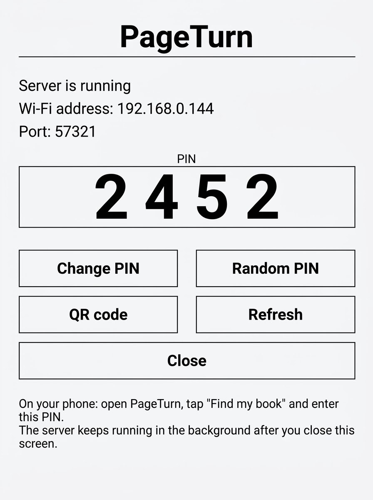
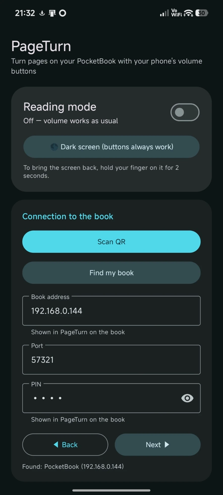

# PageTurn — turn PocketBook pages from your Android phone over Wi-Fi

**English** · [Русский](README.ru.md)

Turn pages in the **stock PocketBook reader** (pbreader) with the volume keys of an Android phone — even with the phone's screen off. No Bluetooth, no firmware changes, no KOReader.

<p align="center">
  
  &nbsp;&nbsp;
  
</p>

| Part | What it does |
|---|---|
| **PageTurn (book)** | A small server on the book receives UDP `next` / `prev` commands and injects hardware key presses into the reader via the official InkView SDK. Also a book-side screen showing IP, port, PIN and a QR code. |
| **PageTurn Remote (Android)** | Captures the volume keys (AccessibilityService) and sends commands to the book. Finds the book on the network, connects via QR, lets you remap keys. |

> ⚠️ **What was tested.** Everything was tested on **one PocketBook 629 (Verse)** and **one Xiaomi 14T Pro running HyperOS 3 (Android 16)** — nothing else. It should in theory work on other Linux-based PocketBook readers (InkView, ARMv7), but that is unverified. Use at your own risk. The firmware is not modified: files are placed on the user storage partition only.

## How it works

```
Phone (volume key) ──UDP "<PIN>:next"──▶ Wi-Fi ──▶ server on the book ──▶ key press ──▶ pbreader
```

- UDP, port **57321**. Packets: `<PIN>:next`, `<PIN>:prev`, `<PIN>:ping`. A valid packet is answered with `PTOK`.
- Auth is a short PIN (4–8 digits) set on the book-side screen; wrong attempts are rate-limited.
- Discovery: the phone broadcasts `PTDISCOVER`, the book replies `PTHERE:<port>:<name>`. Works with the phone's hotspot too.
- The QR code on the book encodes `pageturn://c?h=<ip>&p=<port>&k=<PIN>` so the phone connects with all settings at once.
- Pages turn by sending `IV_KEY_NEXT` / `IV_KEY_PREV` to the active task, like the physical buttons.
- The server keeps Wi-Fi on and prevents the book from sleeping. **This increases battery drain** — stop the server (reboot the book) when you are not reading.

## Install

Download `PageTurn-book-*.zip` and `PageTurnRemote-*.apk` from [Releases](../../releases/latest).

### On the book

1. Connect the book to your computer over USB (storage mode).
2. Extract `PageTurn-book-*.zip` **into the root of the book's drive** — you get `applications/PageTurn.app` and `system/pageturn/…`.
3. *(Recommended)* make `system/pageturn` hidden + system so its files don't show up in the library as "books". On Windows: `attrib +h +s system\pageturn`.
4. Disconnect (or do step 5 first). **PageTurn** appears in the Applications menu.

No libraries need to be copied: the launcher uses the firmware's own libraries from `/ebrmain/lib`.

5. *(Optional, Windows)* get the PageTurn icon in the application menu: with the book still connected, run `add-icon.ps1` from the release (right-click → Run with PowerShell, or `powershell -ExecutionPolicy Bypass -File add-icon.ps1`). Without it the app still works and is listed with a default icon. The script backs up `view.json` and `hash.txt`, edits them, and restores the originals on any error; `-Remove` undoes it. **Tested only on the PocketBook 629 — use at your own risk.** Reboot the book afterwards.

### Adding the icon manually (without the script)

Back up `system/config/desktop/view.json` and `hash.txt` first.

1. In `view.json`, inside the `"applications": {` block, add as the first entry:
   ```json
   "U_pageturn": {
       "focused_icon": { "path": "system/pageturn/icons/desktop_app_pageturn_f.bmp" },
       "icon":         { "path": "system/pageturn/icons/desktop_app_pageturn.bmp" },
       "path": "/mnt/ext1/applications/PageTurn.app",
       "title": "PageTurn"
   },
   ```
2. In the same file, add `"U_pageturn"` to the `"apps"` list of the `"@General"` group (mind the comma after the previous item).
3. Make sure the file is still valid JSON (e.g. paste it into any JSON validator).
4. Update `hash.txt`. It has the form:
   ```
   hash1=<unchanged>
   hash2=<MD5 of view.json, lowercase hex>

   #<CRC32 of the first two lines, 8 lowercase hex digits>
   ```
   Keep `hash1` as is. Compute the new values, for example with Python:
   ```python
   import hashlib, zlib
   d = "E:/system/config/desktop/"
   h1 = [l for l in open(d + "hash.txt") if l.startswith("hash1=")][0].strip()
   h2 = "hash2=" + hashlib.md5(open(d + "view.json", "rb").read()).hexdigest()
   body = h1 + "
" + h2 + "
"
   open(d + "hash.txt", "w", newline="
").write(body + "
#" + format(zlib.crc32(body.encode()), "08x") + "
")
   ```
   (Any tool that computes MD5 and CRC32 works; line endings in `hash.txt` are `
`.)
5. Reboot the book. To undo, restore the two backup files.

If the hash does not match, the book may ignore or reset the desktop configuration — that is why the backups matter.

### On the phone

1. Install `PageTurnRemote-*.apk` (allow installs from unknown sources; the APK is signed with a debug key).
2. Open the app and grant permissions (camera for QR, notifications).
3. Enable **Accessibility → PageTurn Remote**. Without it the volume keys cannot be captured. On Xiaomi you may need to allow "restricted settings" for the app first.
4. Connect: **Scan QR** on the book's QR screen, or **Find my book** + PIN, or enter IP/port/PIN manually.
5. Turn on reading mode. Default: volume down = next page, volume up = previous (remappable).

The phone and the book must be on the same network, or the book must join the phone's hotspot.

## Using it on the book

1. Launch **PageTurn** from the Applications menu: the server starts in the background and the screen opens.
2. The screen shows the Wi-Fi address, port and **PIN**. Buttons: *Change PIN*, *Random PIN*, *QR code*, *Refresh*, *Close*.
3. *Close* only closes the screen — **the server keeps running**. To stop it, reboot the book.
4. There is no autostart on boot (the firmware's root filesystem is read-only and was left untouched): open the app once after each power-on.
5. The first launch can take a while as Wi-Fi comes up.

The UI follows the book's system language: en, ru, uk, de, fr, es, it (English otherwise).

## Phone with the screen off

On the tested Xiaomi (HyperOS 3), roughly 10–15 seconds after the screen turns off the system stops delivering volume-key presses to services. How your device behaves is unknown — it may well work fine without any workaround.

If you hit the same problem, what worked on that Xiaomi is **Dark screen** mode: the app keeps the screen on at minimum brightness showing a black page (also over the lock screen). To wake the display, hold a finger on it (there is a hint in the app). It works with the phone lying face down.

There is an auto-off timer so the volume keys are not captured forever, and a Quick Settings tile.

## Building from source

```
android/   Android Studio / Gradle project (Kotlin, Material 3, ZXing)
book/src/  C sources of the book side (server.c, ui.c, qr.c)
book/bin/  prebuilt binaries for the PocketBook 629
```

**Android** (JDK 17, Android SDK):

```bash
cd android && ./gradlew assembleDebug
```

**Book** — cross-compile in Docker:

1. Put the headers from [pocketbook/SDK_6.3.0](https://github.com/pocketbook/SDK_6.3.0) (branch 6.5, `inkview.h`) into `book/src/`. They are not included in this repo.
2. Put `book/toolchain.tar.bz2` — the Bootlin armv7-eabihf glibc toolchain.
3. Copy the link-time libraries from the book into `book/libs/` (`tools/collect-libs.app` puts them into a `pageturn-libs` folder on the book; **do not publish firmware files**).
4. `docker run --rm -v "$PWD/book:/work" debian:bookworm-slim bash /work/build.sh`
5. `book/patch.ps1 -Files out/pageturn,out/pageturn-ui`.

Note: the book is soft-float EABI5 while the toolchain is hard-float, so the ELF is patched after linking (`e_flags = 0x05000200`, interpreter `ld-linux.so.3`). The QR encoder is custom (Reed–Solomon, versions 1–6, ECC level M) and was verified against ZXing.

## Limitations

- Wi-Fi only, single subnet (broadcast discovery does not cross routers).
- The PIN travels over UDP **unencrypted**. It protects against a neighbour on the same network turning your pages by accident, not against a determined attacker.
- The server keeps the book awake — higher battery use.
- No autostart on boot.
- Tested only on PocketBook 629 + Xiaomi 14T Pro / HyperOS 3.

## Uninstall

Run `add-icon.ps1 -Remove` if you used it, then delete `applications/PageTurn.app` and `system/pageturn` from the book and reboot it. On the phone, disable the accessibility service and uninstall the app.

## License and disclaimer

MIT, see [LICENSE](LICENSE). Not affiliated with PocketBook; uses only the public SDK. Install at your own risk.
